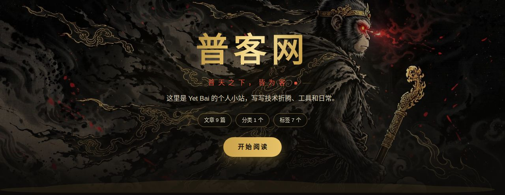
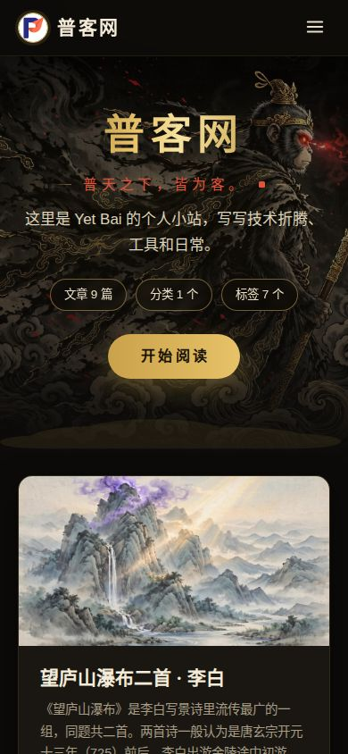
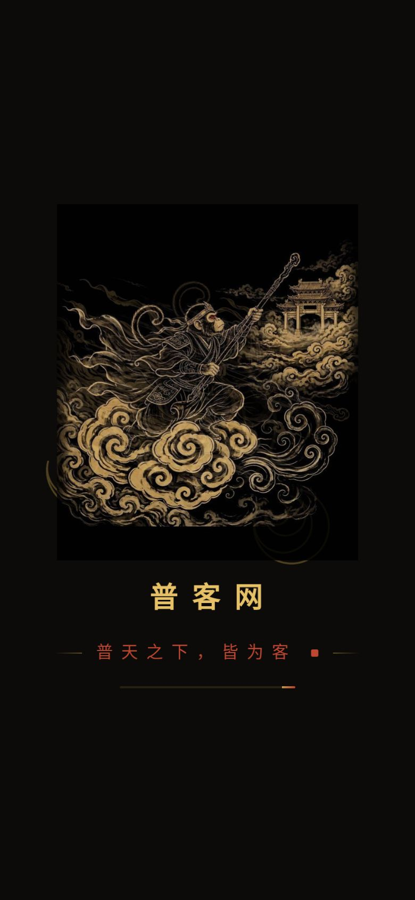
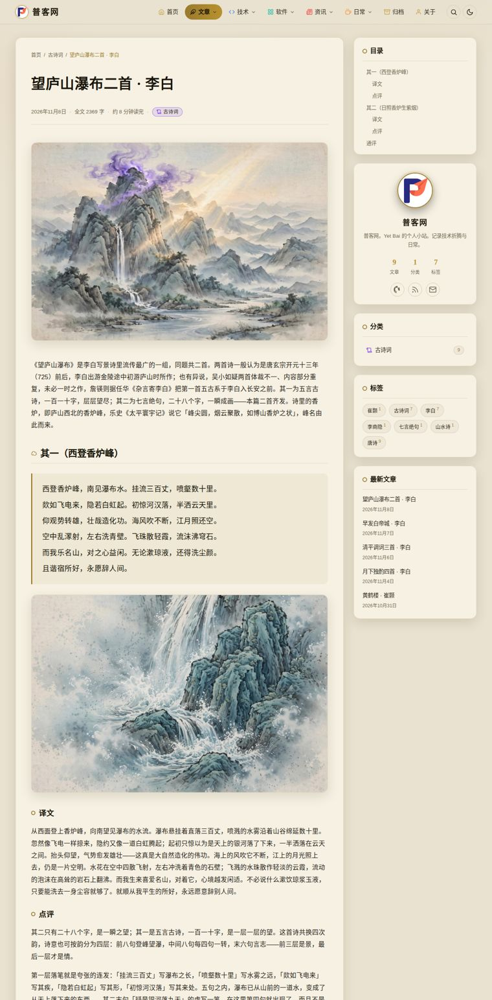

# Tobpage

一款暗黑西游风的 Hugo 主题：墨黑打底、鎏金主色、朱砂点缀，骨架借鉴 Butterfly × AnZhiYu 的双栏卡片流。由 [普客网](https://puke.eu.org/) 自研自用，与 WordPress 主题 TobPress 成对。

**演示站**：https://puke.eu.org/

## 截图

桌面端 Hero：



手机端首页：



开场动画收尾帧（大圣棍指南天门）：



浅色模式文章页：



## 特性

- **双栏卡片流**：文章卡片 + 粘性侧栏（作者卡、分类、标签云、最新文章），桌面与移动端各自适配
- **两段式孙悟空开场动画**：仅首页渲染、每次打开首页播放——v11「在飞」打头（加载中），加载完成交叠切 v12「棍指南天门」收尾，3 秒内必退场；减动效偏好下不播放
- **五大栏目两级分类 + 彩色图标**：文章 / 技术 / 软件 / 资讯 / 日常，各含二级分类，内置彩色图标与分组分类页
- **深浅双色**：一键切换并持久化，浅色为深灰纸面
- **中文字数与阅读时长**：按中文字符正确计数，卡片与文章页显示「N 字 · 约 M 分钟」
- **本地搜索**：JSON 索引按需加载，无外部服务依赖
- **文章目录 + 阅读进度**：侧栏 TOC 锚点导航，顶部金→赤渐变进度条
- **归档时间线**：按年月分组，中文月份
- **页脚信息区**：备案号、运行天数等均由站点参数配置（见下），主题本身不带任何站点默认值

## 环境要求

- Hugo **扩展版（extended）**，已在 **0.169.0** 上验证构建（theme.toml 声明下限 0.120.0）

## 安装

```bash
git clone https://github.com/tobaye/Tobpage.git themes/tobpage
```

在站点 `hugo.toml` 里启用：

```toml
theme = "tobpage"
```

## 关键参数

主旨语、建站日期、备案号、Hero 图等全部是**站点参数**，主题内没有任何普客网的默认值——不配就不渲染：

```toml
[params]
  heroImage = "/img/hero-wukong.jpg"   # Hero 背景图（可替换为任意图）
  ogImage = ""                          # 分享预览图（og:image / twitter:image）默认值，可空（见下）

[params.assets]
  favicon = ""                          # 站点图标路径，可空（见下）

[params.tobpage]
  heroMotto = "普天之下，皆为客。"       # Hero 与开场动画的主旨语
  sealText = "普客网印"                # 主旨行右端的印章文字（4 字，篆书竖排 2×2）
  startDate = "2026-10-29"             # 页脚「本站已运行 X 天」的起算日
  moeIcp = "萌ICP备20269123号"          # 页脚备案号
  moeIcpURL = "https://icp.gov.moe/?keyword=20269123"  # 备案链接
```

分享预览图（`og:image` / `twitter:image`）：文章页优先用该文的 `cover.image`；没有时依次回退站点参数 `ogImage`、`heroImage`，再没有就用主题自带的 `img/hero-wukong.jpg`，输出恒为绝对地址。想全站统一一张分享图，配 `ogImage` 即可。

站点图标（favicon）：配了 `params.assets.favicon` 就用站点自己的文件；不配则自动用主题自带的 `static/favicon.svg`（墨黑底、鎏金云纹、朱砂点），不会 404。想换图，把自己的 `favicon.svg` 放进站点 `static/` 同名覆盖即可。

栏目体系（分类名→栏目/图标/配色）在主题的 `layouts/partials/category-meta.html` 一处定义，换栏目改这一处即可；大圣视觉素材在 `static/img/`，替换同名文件即可换图。

## 字体出处

站名整图 `static/img/hero-title.webp`（站点以 `params.tobpage.titleImage` 启用）由两款字体离线合成：大字为马善政毛笔体（Ma Shan Zheng，Google Fonts，SIL Open Font License 1.1）；印章篆字字形源为全字庫說文解字，數位發展部，CNS11643中文標準交換碼全字庫網站，https://www.cns11643.gov.tw ，依《政府資料開放授權條款－第 1 版》使用。合成脚本存于主题仓 `assets-src/`。页面文字全部使用系统字体，无外部字体请求。

## 许可

MIT，见 [LICENSE](LICENSE)。
